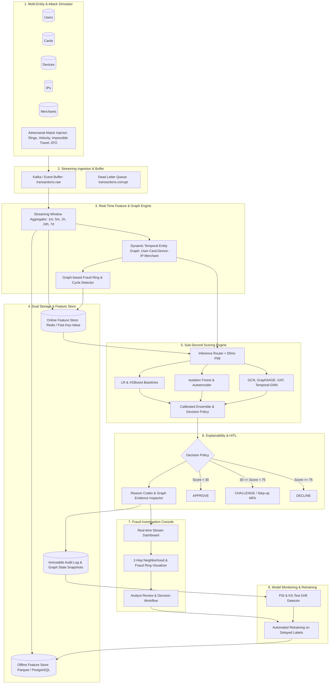

# System Architecture & Technical Specification

## Project: Production-Grade Real-Time Graph Fraud Detection Platform

---

## 1. End-to-End System Data Flow

---

## 2. Dynamic Heterogeneous Entity Graph Model

### Entity Schema & Node Typing
| Node Type | Primary Identifier | Intrinsic Node Features | Graph Role |
| :--- | :--- | :--- | :--- |
| **User** | `user_id` | `[account_age_days, kyc_level, historical_tx_count, base_risk_score]` | Identity Anchor |
| **Card** | `card_id` | `[brand_enc, type_enc, issuer_country_enc, card_age_days]` | Financial Instrument |
| **Device** | `device_id` | `[os_enc, browser_enc, is_emulator, is_rooted, fingerprint_entropy]` | Hardware Fingerprint |
| **IP** | `ip_address` | `[asn_number, is_vpn, is_tor, is_datacenter, geo_country_enc]` | Network Anchor |
| **Merchant** | `merchant_id` | `[mcc_category, historical_chargeback_rate, risk_tier]` | Terminal Destination |
| **Address** | `address_id` | `[address_type_enc, is_po_box, geo_hash_int]` | Physical Location |

### Relationship Schema & Directed Temporal Edges
- `(User) -[OWNS {since_ts}]-> (Card)`
- `(User) -[USES_DEVICE {last_used_ts, session_count}]-> (Device)`
- `(Device) -[CONNECTED_FROM {timestamp}]-> (IP)`
- `(Card) -[TRANSACTED {tx_id, amount, timestamp, channel}]-> (Merchant)`
- `(User) -[SHIPS_TO {is_billing}]-> (Address)`

---

## 3. Evolutionary Model Progression Hierarchy

```mermaid
flowchart LR
    M1["1. Logistic Regression (Linear + Calibrated)"] --> M2["2. XGBoost (Non-linear Tabular Champion)"]
    M2 --> M3["3. Isolation Forest (Unsupervised Baseline)"]
    M3 --> M4["4. Deep Autoencoder (PyTorch Reconstruction Loss)"]
    M4 --> M5["5. GCN (Spectral Graph Convolution)"]
    M5 --> M6["6. GraphSAGE (Inductive Neighborhood Mean/Pool)"]
    M6 --> M7["7. GAT (Multi-Head Edge Attention)"]
    M7 --> M8["8. Temporal GNN (Decay Kernel + Node History)"]
```

### Mathematical Foundations:
1. **GraphSAGE Inductive Layer**:
   $$h_v^{(k)} = \sigma \left( W^{(k)} \cdot \left[ h_v^{(k-1)} \parallel \text{AGG} \left( \{ h_u^{(k-1)} : u \in \mathcal{N}(v) \} \right) \right] \right)$$
2. **Graph Attention Layer (GAT)**:
   $$\alpha_{uv} = \frac{\exp \left( \text{LeakyReLU} \left( \mathbf{a}^T [W h_u \parallel W h_v] \right) \right)}{\sum_{k \in \mathcal{N}(u)} \exp \left( \text{LeakyReLU} \left( \mathbf{a}^T [W h_u \parallel W h_k] \right) \right)}$$
   $$h_u' = \sigma \left( \sum_{v \in \mathcal{N}(u)} \alpha_{uv} W h_v \right)$$
3. **Temporal Edge Decay Kernel**:
   $$\kappa(\Delta t) = \exp(-\lambda \cdot (t_{\text{current}} - t_{\text{edge}}))$$

---

## 4. Leakage-Safe Offline/Online Feature Consistency

### The "Time-Travel" Leakage Trap
In static machine learning benchmarks, features like `user_tx_count_last_24h` are often computed across the full table without strict temporal bounds, contaminating training rows with future signals.

### Point-in-Time Correctness Guarantee
For every training example $i$ at timestamp $T_i$:
$$\mathbf{x}_i = \mathcal{F}(\mathcal{D}_{\le T_i})$$
No transaction, graph edge, or chargeback label occurring at $t > T_i$ is visible to feature computation. Online inference queries the live state at $t = T_{\text{now}}$, ensuring mathematical parity between offline training matrices and online feature store vectors.

---

## 5. Cost-Sensitive Decision Theory & Threshold Optimization

Rather than using an arbitrary threshold of 0.5, the optimal cutoff $p^*$ minimizes total expected financial cost:

$$\text{Total Cost}(p) = C_{FP} \cdot FP(p) + C_{FN} \cdot FN(p)$$

Where:
- $C_{FP} = \$15$ (Customer friction, 2FA delivery, customer service overhead, lost merchant interchange)
- $C_{FN} = \text{Transaction Amount}$ (Unrecovered chargeback fraud loss + chargeback processing fee)

The optimal threshold is computed dynamically:
$$p^* = \arg\min_{p \in [0, 1]} \sum_{i} \left[ C_{FP} \cdot \mathbb{I}(\hat{y}_i(p)=1, y_i=0) + C_{FN, i} \cdot \mathbb{I}(\hat{y}_i(p)=0, y_i=1) \right]$$
